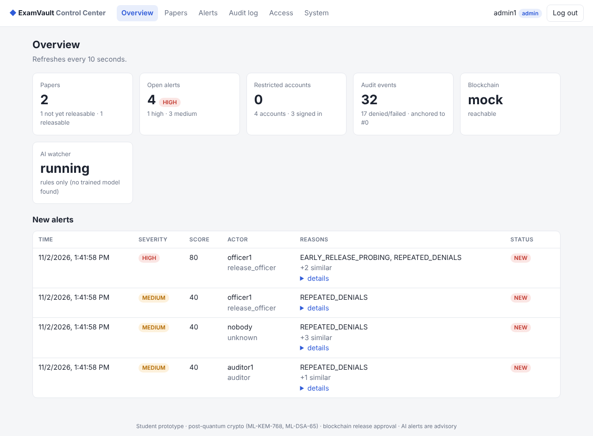
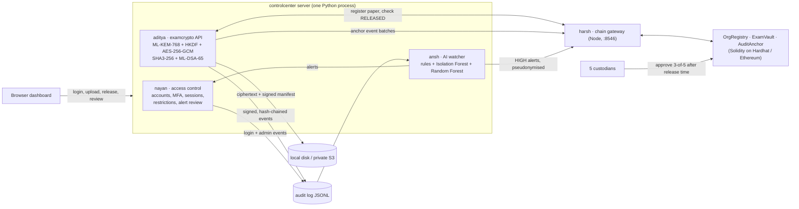
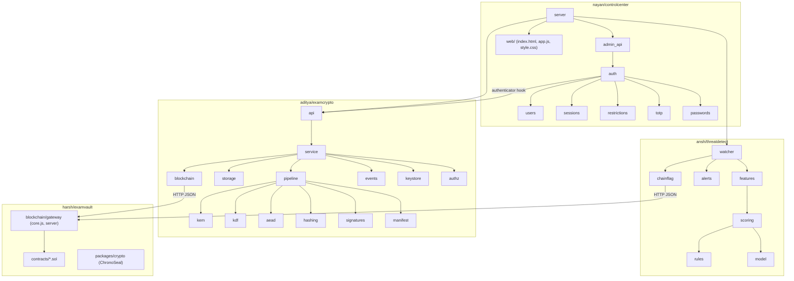
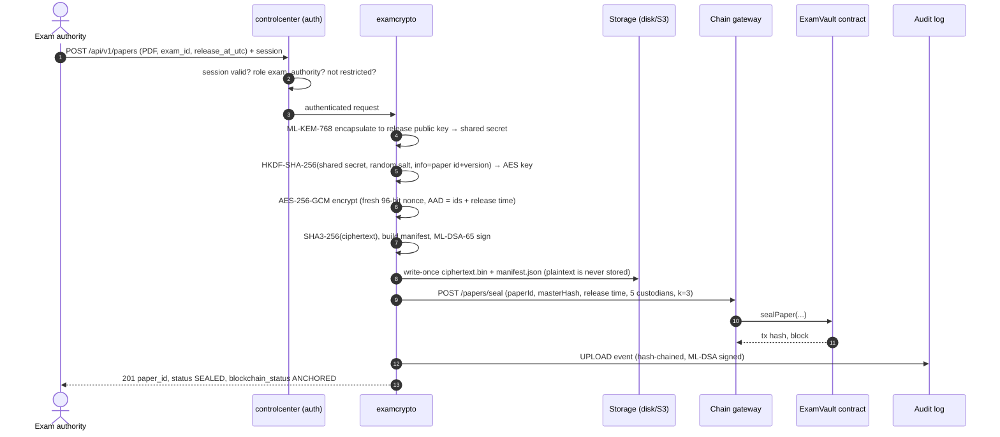
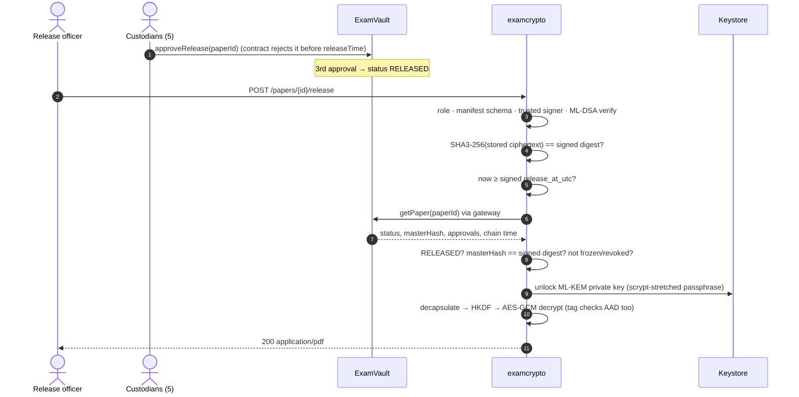
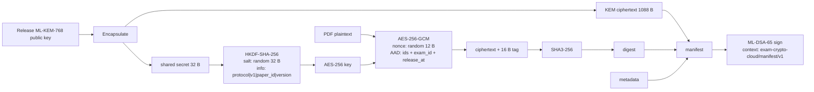
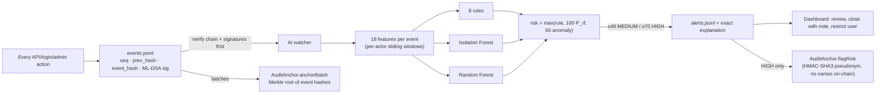
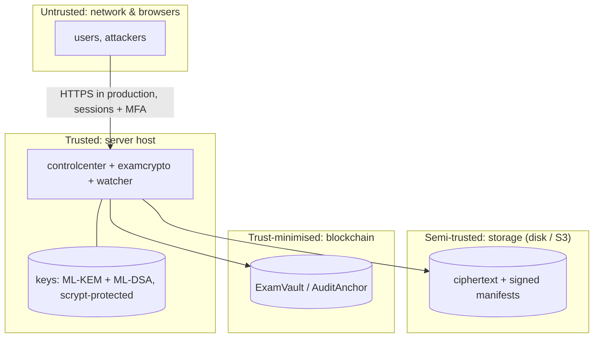

# ExamVault: Secure Examination Paper Distribution and Audit System

B.Tech capstone project, MIT World Peace University, Pune. Guide: **Shital Kakad**.

Exam papers are encrypted with **post-quantum cryptography** and can be opened only when two things
are true: the **release time has passed**, and **3 of 5 custodians have approved on a blockchain**.
Every action goes into a **signed, tamper-evident audit log**. An **AI threat detector** watches that
log, and an **administrator dashboard** is where alerts are reviewed and access is controlled.

> This is a student prototype. It has not had a security audit and is not a production system.
>
> **Team change:** Ansh and Nayan left the project. Their modules (`ansh/`, `nayan/`) were built by
> Aditya, and Aditya and Harsh now maintain them.

📄 **Full project report:** [docs/REPORT.md](docs/REPORT.md) · ▶️ **How to run:** [section 14](#14-how-to-run)



**Quick start** (Windows PowerShell; full guide in [section 14](#14-how-to-run)):

```powershell
git clone https://github.com/adityarenushe21/exam-crypto-cloud.git; cd exam-crypto-cloud
py -3.14 -m venv .venv; .\.venv\Scripts\Activate.ps1
python -m pip install -r aditya\requirements.txt -r ansh\requirements.txt
python run_all_tests.py                                   # all suites should say PASS
cd aditya; python -m examcrypto init-keys; cd ..\nayan     # once: choose a key passphrase
python -m controlcenter demo-users                        # once: note the 4 demo logins
$env:EXAM_DEMO_MODE = "1"; python -m controlcenter serve  # open http://127.0.0.1:8000
```

---

## Contents

1. [Architecture at a glance](#1-architecture-at-a-glance)
2. [Components](#2-components)
3. [How a paper is sealed](#3-how-a-paper-is-sealed)
4. [How a paper is released](#4-how-a-paper-is-released)
5. [Cryptographic design](#5-cryptographic-design)
6. [Data formats](#6-data-formats)
7. [Audit log, anchoring and AI monitoring](#7-audit-log-anchoring-and-ai-monitoring)
8. [Access control](#8-access-control)
9. [Trust boundaries and threat model](#9-trust-boundaries-and-threat-model)
10. [Repository layout](#10-repository-layout)
11. [APIs](#11-apis)
12. [Technology stack](#12-technology-stack)
13. [Testing](#13-testing)
14. [How to run](#14-how-to-run): setup, tests, demo, real blockchain, S3, CLI, configuration, troubleshooting
15. [Honest status and limitations](#15-honest-status-and-limitations)
16. [Team and ownership](#16-team-and-ownership)

---

## 1. Architecture at a glance



Four modules sit in one repository. In normal use one Python process (`controlcenter serve`) hosts
the dashboard, the login and admin API, the paper API, and the AI watcher thread. The blockchain sits
behind a small Node gateway, so Python never holds an Ethereum private key.

**Release rule.** Every check below must pass, in this order. The first failure stops the release
(fail closed). The contract itself accepts custodian approvals only once the *block time* has
passed the release time, so a wrong server clock alone cannot open a paper:

> right role → manifest is well formed → signer is the trusted key → ML-DSA signature valid → stored
> ciphertext matches the **signed** SHA3-256 digest → **signed** release time has passed →
> **ExamVault reports `RELEASED` (3 of 5 custodians)** and the on-chain hash matches → **only then** is the ML-KEM private key unlocked to decrypt.

## 2. Components

| Folder | Module | What it does | Owner | Tests |
|---|---|---|---|---|
| [`aditya/`](aditya/README.md) | **examcrypto** | Secure upload, post-quantum hybrid encryption, write-once storage (local or S3), release service, REST API, signed audit events | Aditya | 107 Python |
| [`harsh/examvault/`](harsh/examvault/README.md) | **Blockchain integrity** | Smart contracts `OrgRegistry`, `ExamVault` (k-of-n custodian release, freeze or revoke), `AuditAnchor` (Merkle batches, risk flags); chain gateway; ChronoSeal JS crypto library | Harsh | 27 Hardhat, 11 gateway, 7 crypto |
| [`ansh/`](ansh/README.md) | **threatdetect** | Turns audit events into features, scores them with rules + Isolation Forest + Random Forest, and explains each alert. Stores alerts append-only and flags HIGH alerts on-chain under a pseudonym | (Ansh) → Aditya | 27 Python |
| [`nayan/`](nayan/README.md) | **controlcenter** | Accounts, scrypt passwords, TOTP MFA, lockout, sessions, restrictions, alert review, admin API, dashboard, one-process server | (Nayan) → Aditya | 32 Python + 16 browser checks |



## 3. How a paper is sealed



If the chain is down at upload time, the paper is still stored, with `blockchain_status: PENDING`.
`POST /papers/{id}/anchor` sends the registration again later. A paper that is not registered on
the chain can **never** be released.

## 4. How a paper is released



The error codes are specific, so the dashboard and the AI can tell probing apart from honest mistakes:

| HTTP | Examples |
|---|---|
| 401 / 403 | `AUTH_REQUIRED`, `ROLE_NOT_ALLOWED`, `ACCOUNT_RESTRICTED` |
| 422 | `SIGNATURE_INVALID`, `UNTRUSTED_SIGNER`, `CIPHERTEXT_DIGEST_MISMATCH`, `DECRYPTION_AUTHENTICATION_FAILED`, `CHAIN_RECORD_MISMATCH` |
| 423 | `RELEASE_TIME_NOT_REACHED`, `CHAIN_NOT_RELEASED`, `CHAIN_PAPER_BLOCKED` |
| 503 | `CHAIN_UNAVAILABLE`, `STORAGE_UNAVAILABLE` (fail closed: nothing is released) |

Custodians can also **freeze** or **revoke** a paper on-chain. A k-of-n proposal does this, for
example when a leak is suspected. Release is then refused with `CHAIN_PAPER_BLOCKED`.

## 5. Cryptographic design

"Option A" uses only standardised algorithms:

| Purpose | Algorithm | Standard | Why |
|---|---|---|---|
| Key encapsulation | **ML-KEM-768** | NIST FIPS 203 | Post-quantum; a harvest-now-decrypt-later attacker cannot open papers later |
| Key derivation | **HKDF-SHA-256** | RFC 5869 | Binds the AES key to the paper id and version (`info`) and a random salt |
| Content encryption | **AES-256-GCM** | NIST SP 800-38D | Authenticated encryption; AAD binds the public metadata (ids, release time) |
| Integrity hash | **SHA3-256** | NIST FIPS 202 | Ciphertext digest; also the on-chain `masterHash` |
| Signatures | **ML-DSA-65** | NIST FIPS 204 | Post-quantum signatures on manifests and audit events, with separate keys |
| Key-file protection | **scrypt** (N=2¹⁵, r=8, p=1) → PKCS#8 PBES2 | RFC 7914 | Slows down passphrase guessing if the key folder is stolen |
| Passwords | **scrypt** + per-user salt | RFC 7914 | Dashboard accounts |
| MFA | **TOTP** (HMAC-SHA1, 30 s, ±1 step, replay-blocked) | RFC 6238 | Works with standard authenticator apps |



**How this differs from the original PPT plan.** The plan named AES-256, SHA-256 and RSA. RSA and
ECDSA can be broken by a large quantum computer, and an exam archive must stay confidential, so we
moved to the NIST post-quantum standards from 2024. AES-256 stays because it is quantum-resistant at
this key size. Harsh's ChronoSeal library (AES-256-GCM, Shamir secret sharing, Merkle trees,
RSA-OAEP, ECDSA) is kept as a tested alternative design. The integrated system uses Option A.

## 6. Data formats

**Storage layout** (write-once; the same keys are used locally and on S3):

```
papers/<paper_id>/v<version>/ciphertext.bin     AES-GCM ciphertext + tag
papers/<paper_id>/v<version>/manifest.json      {"manifest": {...}, "signature_b64": "..."}
events/events.jsonl                             signed, hash-chained audit events
access/restrictions.jsonl                       append-only restriction history
alerts/alerts.jsonl                             append-only alert history
```

**Manifest v1** (strict schema; unknown or missing fields are rejected):
`schema_version, paper_id, paper_version, exam_id, created_at_utc, release_at_utc, content_type,
plaintext_size, kem_algorithm, recipient_key_id, kem_ciphertext_b64, kdf_algorithm, hkdf_salt_b64,
hkdf_info, aead_algorithm, aes_gcm_nonce_b64, aad, hash_algorithm, ciphertext_sha3_256_hex,
signature_algorithm, signature_context, signer_key_id`

**Audit event**: `event_id`, `event_type`, `timestamp_utc`, `source_component`, `request_id`,
`actor_id`, `actor_role`, `result`, `reason_code`, paper fields (`paper_id`, `paper_version`,
`exam_id`, digests) and admin fields (`action`, `target_actor_id`, `alert_id`), plus the chain
fields `seq`, `prev_hash`, `event_hash`. The `event_hash` is SHA3-256 of the canonical JSON, and an ML-DSA-65 signature is made with the
**audit** key, which is separate from the manifest key.

**On-chain paper record** (ExamVault): `paperId = keccak256("<paper_id>:v<n>")`, `masterHash`
(the SHA3-256 digest), `manifestRoot`, `releaseTime`, custodian set, threshold, status
(`SEALED → RELEASED`, or `FROZEN` / `REVOKED`).

## 7. Audit log, anchoring and AI monitoring



- **Tamper evidence.** Changing, deleting or reordering any event breaks the hash chain or a
  signature, and `GET /events/verify` reports the first bad `seq`. Batches anchored on-chain mean
  that even an administrator who rewrites the whole file is detected.
- **Detectors.** Rules catch known patterns, for example `INTEGRITY_FAILURE`,
  `AUTH_FAILURE_BURST`, `EARLY_RELEASE_PROBING`, `ROLE_PROBING`, `BLOCKED_PAPER_ACCESS` and
  `OFF_HOURS_BULK_ACCESS`. The Random Forest learns labelled patterns. Isolation Forest catches
  unusual behaviour that nobody labelled, but it is capped at MEDIUM so it can never trigger a
  restriction by itself.
- **Explanations.** The PPT planned SHAP. We use **exact** explanations instead: which rules fired,
  plus the Random Forest's decision-path feature contributions. These are exact for tree models, and
  they avoid a heavy dependency.
- **Humans decide.** HIGH means `TEMPORARY_RESTRICT` is *recommended*. An administrator reviews
  the alert and can apply a restriction from the alert in one click. Closing an alert requires a note.

## 8. Access control

| Role | Can |
|---|---|
| `exam_authority` | upload papers and new versions; view status |
| `release_officer` | release a paper (only once every check passes) |
| `admin` | manage users, restrictions and alerts; anchor events; view everything |
| `auditor` | read-only: events, verification, alerts, papers |

- Passwords: scrypt with a password policy. MFA: TOTP, with each code usable only once.
- **Lockout**: 5 failures in 15 minutes lock the account for 15 minutes. An unknown user gets the
  same error and timing as a wrong password, so attackers cannot discover usernames.
- **Sessions**: random tokens, stored only as SHA-256 hashes. They expire after 30 minutes idle or
  8 hours in total. Logout and restriction revoke them.
- **Restrictions**: append-only and they can expire. They are checked on **every request**, not
  only at login. An admin cannot restrict themselves or the last other active admin.
- **Dashboard**: vanilla JS with a strict Content-Security-Policy (no inline script) and
  `textContent` only, so no HTML injection is possible.

## 9. Trust boundaries and threat model



| Threat | Mitigation | Tested by |
|---|---|---|
| Stolen storage bucket or disk | Only ciphertext is stored; the key is never in storage | pipeline tests, S3 fake-client tests |
| Tampered ciphertext or manifest | SHA3 digest inside the ML-DSA-signed manifest; GCM tag | insider-attack tests |
| Insider re-signs a manifest with their own key | Trusted signer key id is pinned; `UNTRUSTED_SIGNER` | `test_attacker_resigns_*`, `test_*_resigned` |
| Early release (clock or insider) | Signed release time **and** k-of-n custodian approval on-chain; chain time checked | chain-rule tests, real Hardhat run |
| Single rogue custodian or admin | 3-of-5 threshold; admin role cannot release | Hardhat tests, API role tests |
| Swapping the paper after sealing | On-chain `masterHash` must equal the signed digest | `CHAIN_RECORD_MISMATCH` tests |
| Audit log edited after the fact | Hash chain + ML-DSA signatures + on-chain Merkle anchors | audit-chain tests |
| Password guessing / credential stuffing | scrypt, lockout, TOTP, AI `AUTH_FAILURE_BURST` | controlcenter tests, mutation tests |
| Stolen session token | Hashed at rest, idle and absolute expiry, revoked on restriction | session tests |
| Stolen key folder | scrypt-stretched passphrase (N=2¹⁵) before PKCS#8 encryption | `test_passphrase_is_scrypt_stretched` |
| Future quantum attacker | ML-KEM-768 and ML-DSA-65 | — (by design) |

**Out of scope:** leaks after a legitimate release (photos of a printed paper), a fully compromised
server host while it is running, and side channels. As the PPT said, the system reduces risk inside
the digital workflow. It does not claim to stop leaks outside it.

## 10. Repository layout

```
exam-crypto-cloud/
├── README.md                     ← you are here (architecture)
├── docs/REPORT.md                ← full capstone report
├── run_all_tests.py              ← runs every suite, prints PASS/FAIL table
├── aditya/                       examcrypto: crypto, storage, release service, API, audit events
│   ├── examcrypto/               kem, kdf, aead, hashing, signatures, manifest, pipeline, service,
│   │                             storage, blockchain, events, keystore, authz, api, cli
│   ├── tests/                    107 tests      scripts/benchmark.py
│   └── docs/                     API_CONTRACT.md, AWS_S3_SETUP.md
├── harsh/examvault/
│   ├── blockchain/contracts/     OrgRegistry.sol, ExamVault.sol, AuditAnchor.sol
│   ├── blockchain/gateway/       Node HTTP gateway (Python ↔ chain)
│   ├── blockchain/scripts/       setup-local, custodian-approve, custodian-freeze
│   └── packages/crypto/          ChronoSeal library
├── ansh/threatdetect/            schema, features, rules, model, scoring, watcher, alerts,
│                                 chainflag, synthetic, evaluate, cli   (+ reports/evaluation.md)
└── nayan/controlcenter/          passwords, totp, users, sessions, restrictions, auth,
                                  admin_api, server, cli, web/   (+ docs/screenshots/)
```

## 11. APIs

**Paper API** (examcrypto, `/api/v1`). Full contract: [aditya/docs/API_CONTRACT.md](aditya/docs/API_CONTRACT.md)

| Method | Path | Role |
|---|---|---|
| POST | `/papers` · `/papers/{id}/versions` | exam_authority |
| GET | `/papers/{id}` · `/papers/{id}/manifest` | authority, officer, admin, auditor |
| POST | `/papers/{id}/release` | release_officer |
| POST | `/papers/{id}/anchor` | exam_authority |
| GET | `/events` · `/events/verify` | admin, auditor |
| POST | `/events/anchor` | admin |

**Control-centre API** (controlcenter): `POST /auth/login|logout`, `GET /auth/me`,
`GET /dashboard/overview|papers`, `GET /alerts`, `POST /alerts/{id}/review|restrict`,
`GET|POST /access/users`, `POST /access/users/{u}/restrict|unrestrict`, `GET /access/restrictions`,
`GET /system/health`.

**Chain gateway** (Node, `:8546`): `POST /papers/seal`, `GET /papers/{id}/{v}`, `POST /audit/anchor`,
`GET /audit/last-seq`, `POST /risk/flag`.

## 12. Technology stack

| Layer | Used | Planned in the PPT |
|---|---|---|
| Crypto | Python `cryptography` 46+ (ML-KEM, ML-DSA, AES-GCM, HKDF, scrypt), `hashlib` SHA3 | AES-256, SHA-256, RSA |
| API / server | Flask 3 (one process) | Node.js / Express |
| Frontend | Vanilla JS + CSS, strict CSP | React |
| Blockchain | Solidity 0.8.24, Hardhat, ethers v6, Node gateway | Solidity, Hardhat, Ganache |
| Storage | Local disk or AWS S3 (boto3, SSE-KMS/SSE-S3, write-once) | AWS S3 + KMS |
| AI | scikit-learn: IsolationForest, RandomForestClassifier | + SHAP |
| Data store | Append-only JSONL files (signed, hash-chained) | PostgreSQL |
| Testing | unittest, Hardhat/Mocha, node:test, Playwright (Chromium) | — |

The changes from the plan were deliberate. Each one is explained in the report, §5.6.

## 13. Testing

| Suite | Count | What it covers |
|---|---|---|
| aditya | 107 | pipeline, insider attacks, CLI, API and HTTP codes, chain rules, audit chain, S3 (fake client), gateway client, key protection |
| ansh | 27 | features, rules, model, scoring, explanations, watcher, alert store, chain flags |
| nayan | 32 | passwords, TOTP, lockout, sessions, restrictions, admin API, end-to-end with examcrypto |
| harsh Hardhat | 27 | contracts (19) + gateway against real contracts (8) |
| harsh gateway unit / crypto | 11 / 7 | gateway logic / ChronoSeal |
| Browser | 16 checks | all 4 roles in real Chromium, phone width, no JS errors |
| Mutation | 14 bugs | deliberate security bugs in controlcenter, all caught |

Run everything with `python run_all_tests.py`. Performance: `python aditya/scripts/benchmark.py`
(see the report for figures).

## 14. How to run

Commands are for **Windows PowerShell**. Linux/macOS equivalents are at the end of this section.
Unless a step says otherwise, run each command from the repository folder (`exam-crypto-cloud`)
with the virtual environment active.

### 14.0 Prerequisites

| Need | Version | For |
|---|---|---|
| Python | 3.13 or newer (tested on 3.13 and 3.14) | everything in `aditya/`, `ansh/`, `nayan/` |
| Git | any | cloning and updates |
| Node.js LTS | 22 or 24 | only for Harsh's blockchain parts (14.3, 14.4) |
| AWS account | — | only for S3 storage (14.5) |

### 14.1 Set up once

```powershell
git clone https://github.com/adityarenushe21/exam-crypto-cloud.git
cd exam-crypto-cloud
py -3.14 -m venv .venv
.\.venv\Scripts\Activate.ps1
python -m pip install -r aditya\requirements.txt -r ansh\requirements.txt
```

To get updates later: `git pull`. If PowerShell blocks `Activate.ps1`, run
`Set-ExecutionPolicy -Scope CurrentUser RemoteSigned` once.

### 14.2 Run all tests

```powershell
python run_all_tests.py
```

**Expected:** `PASS` for aditya (107), ansh (27) and nayan (32).

To include Harsh's suites, install Node.js first, then:

```powershell
cd harsh\examvault\packages\crypto; npm install; cd ..\..\blockchain; npm install; cd ..\..\..
python run_all_tests.py --hardhat
```

**Expected:** crypto 7, gateway 11, and Hardhat 27 passing (19 contract + 8 gateway).

### 14.3 Demo with the mock blockchain (fastest)

```powershell
cd aditya; python -m examcrypto init-keys; cd ..           # once - remember the passphrase
cd nayan; python -m controlcenter demo-users               # once - write the 4 passwords down
$env:EXAM_DEMO_MODE = "1"
python -m controlcenter serve                              # asks for the key passphrase
```

Open **http://127.0.0.1:8000**:

1. Log in as **authority1**, go to Papers, and seal a PDF with a release time 2 minutes away.
2. Log in as **officer1** and try to release it. It is refused: first because the release time has
   not come, then with `CHAIN_NOT_RELEASED`.
3. Approve as the mock custodians (demo only). In a second terminal:
   `Invoke-RestMethod -Method Post http://127.0.0.1:8000/api/v1/_demo/mock-chain/<paper_id>/approve`
4. As **officer1**, click **Release**. The PDF downloads.
5. Log in as **admin1** and open **Alerts**: the AI has flagged the refused attempts. Click
   **Restrict account**, and officer1 is locked out immediately. Under **Audit log**, click
   *Verify* and *Anchor*.

### 14.4 Full system on a real local blockchain (5 terminals)

Do 14.1 and the `npm install` step of 14.2 first.

| Terminal | Folder | Command (leave running unless noted) |
|---|---|---|
| 1 | `harsh\examvault\blockchain` | `npx hardhat node` |
| 2 | `harsh\examvault\blockchain` | `npx hardhat run scripts/setup-local.js --network localhost`, then `npx hardhat run gateway/server.js --network localhost` |
| 3 | `nayan` (venv active) | `$env:EXAM_CHAIN = "gateway"; python -m controlcenter serve --flag-on-chain` |
| 4 | browser | http://127.0.0.1:8000: seal as authority1; release as officer1 is refused |
| 5 | `harsh\examvault\blockchain` | `$env:PAPER_ID = "pap_..."; npx hardhat run scripts/custodian-approve.js --network localhost` (runs once, then exits) |

**What you should see:**
- The paper shows `ANCHORED` with a real `0x…` transaction.
- After the custodians approve, it shows `RELEASED 3/3`, and the officer can release it.
- **HIGH** AI alerts appear in terminal 2 as `AuditAnchor#flagRisk` transactions.
- **Freeze demo:** run `scripts/custodian-freeze.js` with the same `PAPER_ID`. The dashboard shows
  `BLOCKED`, and release is refused.

Restarting `npx hardhat node` wipes the chain. After a restart, run `setup-local.js` again and seal
new papers.

### 14.5 AWS S3 storage

Follow [aditya/docs/AWS_S3_SETUP.md](aditya/docs/AWS_S3_SETUP.md): create a private bucket and an
app user, and set a billing alert first. Then start the server with:

```powershell
$env:EXAM_STORAGE = "s3"; $env:EXAM_S3_BUCKET = "<bucket>"; $env:AWS_PROFILE = "examcrypto"; $env:AWS_REGION = "ap-south-1"
python -m controlcenter serve
```

### 14.6 Command-line tools (no browser)

```powershell
cd aditya
python -m examcrypto make-sample                    # creates output\sample_paper.pdf
python -m examcrypto seal output\sample_paper.pdf --exam-id CS301-ENDSEM --release-at 2026-12-01T09:00:00Z
python -m examcrypto verify <paper_id>
python -m examcrypto release <paper_id>             # refused before the release time
python -m examcrypto verify-events                  # check the signed audit chain
python scripts\benchmark.py --quick                 # timings on this PC

cd ..\ansh
python -m threatdetect evaluate                     # AI evaluation on synthetic data
python -m threatdetect demo

cd ..\nayan
python -m controlcenter create-user --username alice --role release_officer   # asks for a password
python -m controlcenter enable-mfa --username alice # prints a setup key for an authenticator app
python -m controlcenter list-users
```

### 14.7 Configuration

| Variable | Values | Default | Meaning |
|---|---|---|---|
| `EXAM_KEY_PASSPHRASE` | text | asked at start | Passphrase for the key files (avoid in shared terminals) |
| `EXAM_CHAIN` | `mock` / `gateway` | `mock` | Mock chain, or Harsh's gateway to a real chain |
| `EXAM_CHAIN_GATEWAY_URL` | URL | `http://127.0.0.1:8546` | Where the gateway runs |
| `EXAM_STORAGE` | `local` / `s3` | `local` | Where ciphertext and manifests are stored |
| `EXAM_S3_BUCKET`, `EXAM_S3_PREFIX`, `EXAM_S3_KMS_KEY_ID` | text | — | S3 settings (KMS key optional) |
| `CONTROLCENTER_DATA_DIR` | folder | `aditya` | Where `keys/` and `local_storage/` live |
| `EXAM_DEMO_MODE` | `1` | off | Enables demo-only routes such as mock approvals; **never in production** |

`python -m controlcenter serve` options: `--port 8000`, `--no-watcher` (no AI thread),
`--flag-on-chain` (send HIGH alerts to the chain).

### 14.8 Linux / macOS

Use the same commands, with these differences:
- Create and activate the environment with `python3 -m venv .venv` and `source .venv/bin/activate`.
- Use `/` in paths.
- Set variables with `export EXAM_DEMO_MODE=1` instead of `$env:...`.
- Call the demo route with `curl -X POST`.

### 14.9 Troubleshooting

| Problem | Fix |
|---|---|
| `No module named examcrypto` / `controlcenter` | Run the command from the module's folder (`aditya`, `nayan`, `ansh`) with the venv active |
| Wrong passphrase / key error | Use the passphrase from `init-keys`; if it is lost, delete `aditya\keys` and run `init-keys` again (old papers can no longer be opened) |
| `CHAIN_UNAVAILABLE` (503) | Terminals 1 and 2 of 14.4 must be running; or unset `EXAM_CHAIN` to use the mock chain |
| `CHAIN_UNKNOWN_PAPER` after restarting Hardhat | The chain was wiped: run `setup-local.js` again and seal a new paper |
| Port 8000 in use | `python -m controlcenter serve --port 8010` |
| Demo users lost | Delete `aditya\keys\users.json` and run `demo-users` again |

## 15. Honest status and limitations

| Verified | Where |
|---|---|
| examcrypto tests (105 at the time), Harsh's 26 Hardhat tests, gateway, real local-chain seal + anchoring + correct refusals | Aditya's Windows PC (Python 3.14.7, Node 24) |
| All current Python suites (107 + 27 + 32), gateway unit tests, ChronoSeal, 16-step browser walkthrough, benchmark | a Linux test environment |
| Custodian approve → release on the real chain; 27th Hardhat test (risk flag) | **not yet**: pending on Aditya's PC |
| Real AWS S3 | **not yet**: tested against a fake S3 client only ([setup guide](aditya/docs/AWS_S3_SETUP.md)) |
| AI accuracy | **synthetic** data only ([evaluation](ansh/reports/evaluation.md)), not real-world accuracy |

Main limitations:
- Both key pairs live in one local folder (a real system would use an HSM or KMS).
- Release time comes from the server clock plus the chain's block time.
- One exam centre on-chain.
- Flask development server; HTTPS must be added in front for deployment.

## 16. Team and ownership

| Member | Module |
|---|---|
| Aditya Renushe | `aditya/`: upload validation; ML-KEM-768, HKDF-SHA-256, AES-256-GCM, SHA3-256, ML-DSA-65; signed manifest; storage (local + S3); release service with time and chain checks; API; signed, hash-chained audit events; integration. Also built and maintains `ansh/` and `nayan/` |
| Harsh Kapile | `harsh/examvault/`: OrgRegistry, ExamVault and AuditAnchor contracts and their tests; chain gateway and scripts; ChronoSeal |
| Ansh Sahni | AI threat detection (planned design; left the project) |
| Nayan D. Padghan | Alerting, access control and dashboard (planned design; left the project) |

Guide: **Shital Kakad**.
