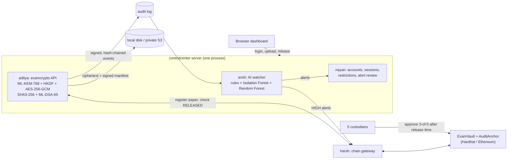

# ExamVault: Secure Examination Paper Distribution and Audit System

B.Tech capstone (MIT World Peace University, Pune). Exam papers are encrypted with **post-quantum
cryptography** and released only when the **release time has passed AND custodians approve on a
blockchain**. Every action is recorded in a **signed, tamper-evident audit log** that an **AI threat
detector** watches; an **administrator dashboard** reviews the alerts and controls access.

> Student prototype, not a security-audited production system. Team change: Ansh and Nayan left
> the project. Their modules (`ansh/`, `nayan/`) were built by Aditya with AI assistance and are
> maintained by Aditya and Harsh.


## Architecture



**Release rule:** right role → signed manifest valid → stored file intact → release time passed →
**ExamVault says RELEASED (3 of 5 custodians)** and the on-chain hash matches → only then is the
ML-KEM private key unlocked to decrypt.

## Modules

| Folder | Module | Owner | Tests |
|---|---|---|---|
| [`aditya/`](aditya/README.md) | Secure upload, post-quantum encryption, storage (local/S3), release service, API, signed audit events | Aditya | 105 Python |
| [`harsh/examvault/`](harsh/examvault/README.md) | Smart contracts (OrgRegistry, ExamVault, AuditAnchor), chain gateway, ChronoSeal library | Harsh | 19 + 8 Hardhat, 11 gateway, 7 crypto |
| [`ansh/`](ansh/README.md) | AI threat detection, alert store, on-chain risk flags | (Ansh) → Aditya + AI | 27 Python |
| [`nayan/`](nayan/README.md) | Access control, alert review, dashboard, one-process server | (Nayan) → Aditya + AI | 32 Python + 16 browser checks |

## Quick start (Windows PowerShell)

```powershell
git clone https://github.com/adityarenushe21/exam-crypto-cloud.git
cd exam-crypto-cloud
py -3.14 -m venv .venv
.\.venv\Scripts\Activate.ps1
python -m pip install -r aditya\requirements.txt -r ansh\requirements.txt
python run_all_tests.py                      # every Python suite (+ Node suites once npm-installed)

cd aditya; python -m examcrypto init-keys; cd ..\nayan
python -m controlcenter demo-users           # prints 4 demo logins ONCE - write them down
$env:EXAM_DEMO_MODE = "1"
python -m controlcenter serve                # open http://127.0.0.1:8000
```

The full guide (real blockchain, custodian approvals, on-chain AI flags, S3) is in
[HOW_TO_RUN_EVERYTHING.md](HOW_TO_RUN_EVERYTHING.md).

## Honest status

| Verified | Where |
|---|---|
| examcrypto 105 tests, Harsh's 26 Hardhat tests (now 27 with risk flags), gateway, real local-chain release flow | Aditya's Windows PC (Python 3.14.7, Node 24) |
| All Python suites, gateway unit tests, 16-step browser walkthrough | Claude's Linux sandbox |
| Real AWS S3 | **not yet**: code tested against a fake S3 client only (`aditya/docs/AWS_S3_SETUP.md`) |
| AI accuracy | measured on **synthetic** data only (`ansh/reports/evaluation.md`), not real-world accuracy |
