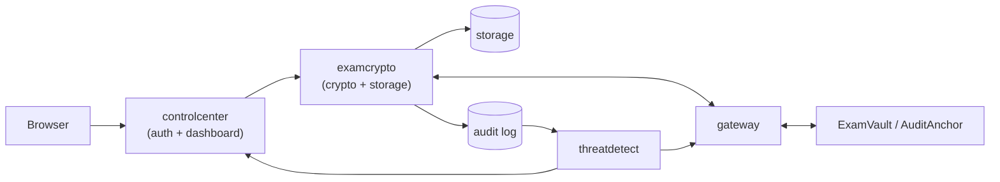
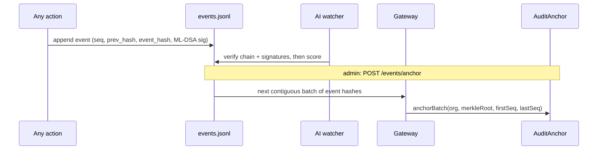

# Blockchain-Based Secure Examination Paper Distribution and Audit System using AI-Based Threat Detection

**B.Tech Capstone Project Report**
MIT World Peace University, Pune · In-house project
**Guide:** Shital Kakad

| Team member | Module |
|---|---|
| Aditya Renushe | Secure upload, encryption and cloud storage |
| Harsh Kapile | Blockchain integrity (smart contracts, gateway) |
| Ansh Sahni | AI threat detection |
| Nayan D. Padghan | Alerting, access control and administrator dashboard |

Repository: <https://github.com/adityarenushe21/exam-crypto-cloud> · Architecture: [README.md](../README.md)

> **Note on verification.** Throughout this report, results are labelled
> with **where they were measured**: on Aditya's Windows PC, or in a Linux test environment.
> Anything not yet verified is labelled as such.

---

## Abstract

Exam papers are leaked mostly through people and centralised portals, not through broken ciphers.
Someone with credentials opens the file early, a storage bucket is misconfigured, or an insider
swaps or copies the paper. This project builds an integrated workflow in which papers are:

1. encrypted at upload with **post-quantum hybrid encryption** (ML-KEM-768 + HKDF-SHA-256 +
   AES-256-GCM) and signed with **ML-DSA-65**;
2. stored only as ciphertext, on local disk or private AWS S3;
3. registered on an **Ethereum smart contract** that releases a paper only after its scheduled time
   **and** after approval by 3 of 5 independent custodians;
4. traced through a **signed, hash-chained audit log** whose batches are anchored on-chain;
5. watched by an **AI threat detector** (rules + Isolation Forest + Random Forest) with exact
   explanations; and
6. managed through an **administrator dashboard** with MFA, lockout, session control and
   human-reviewed access restrictions.

The system was implemented as four modules: Python, Solidity and Node.js, with 211 automated tests,
16 browser checks and 14 mutation tests. The core release flow ran on a real local Ethereum chain:
sealing a paper cost 280,418 gas, and the contract refused early and unapproved release attempts.
Encrypting and signing a 1 MB paper takes about 7 ms (sandbox measurement). On labelled synthetic
data, the combined detector reached F1 = 0.986 at a 0.66 % false-positive rate. Because the data is
synthetic, this figure is optimistic.

---

## 1. Introduction

Question-paper leaks force re-examinations and erode trust in results. In a typical digital
workflow, papers are uploaded to a portal, stored centrally and downloaded by centres before the
exam. Every step depends on trusting the people and systems involved. Once a file is decrypted or
downloaded, the portal does not know whether the access was legitimate.

This project treats the paper as an asset that must be:

- **confidential until a scheduled moment**,
- **releasable only by collective agreement** rather than by any single account,
- **traceable**, so every access attempt leaves evidence that cannot be quietly edited, and
- **monitored**, so suspicious behaviour is noticed before or while it happens.

## 2. Problem statement

From the project proposal:

- Centralised portals can leave question banks exposed to compromised credentials or insider misuse.
- Blockchain-based approaches provide integrity and auditability, but on their own they may not stop
  early opening or detect abnormal access.
- Anomaly-detection systems can flag suspicious behaviour, but may lack an immutable record that
  links each alert to the event behind it.

**Problem addressed.** Exam papers need confidentiality before the scheduled exam, controlled
release at exam time, and traceability of every access event, in one integrated workflow.

## 3. Objectives

| # | Objective (proposal) | Delivered as |
|---|---|---|
| 1 | Secure end-to-end pipeline for encrypting, storing and distributing papers | `examcrypto` seal/verify/release pipeline, local and S3 storage (§5.2) |
| 2 | Tamper-evident, verifiable audit trail | Hash-chained, ML-DSA-signed events + `AuditAnchor` Merkle batches (§5.5) |
| 3 | Time-locked decryption | Signed release time + `ExamVault` approvals accepted only after `releaseTime` (§5.3) |
| 4 | AI behavioural monitoring with risk scores | `threatdetect`: 18 features, 3 detectors, exact explanations (§5.4) |
| 5 | Unified administrator dashboard | `controlcenter` dashboard: overview, papers, alerts, users, restrictions, health (§5.6) |
| 6 | Architecture that scales to multiple centres | Per-centre variants exist in the contract (`verifyVariant`); the prototype uses one centre (§9) |

## 4. Literature survey

| # | Work | Year / venue | Strengths | Gap |
|---|---|---|---|---|
| 1 | Rigan, Rajapakshe, Sulaiman, Butt: *ASSURE-EXAM: A blockchain-based assurance framework for secure and transparent exam paper distribution* | 2025, ACSACW | Smart contracts, time-locking, access control, auditability | No AI behavioural risk scoring |
| 2 | Islam, Kader, Shin: *BSSSQS: A blockchain-based smart and secured scheme for question sharing in the smart education system* | 2019, JICCE | Encryption, blockchain storage, smart-contract unlock, timestamp lock | No real-time behavioural monitoring |
| 3 | Kadam, Kothalkar, Ambawade et al.: *Blockchain-enabled examination platform: a secure approach for academic assessments* | 2024, IEEE ICCCNT | Encrypted exam data, blockchain integrity | No time-locked release combined with AI detection |
| 4 | Liu, Ting, Zhou: *Isolation Forest* | 2008, IEEE ICDM | Efficient unsupervised anomaly detection | Generic; not specific to exam security |
| 5 | Lundberg, Lee: *A unified approach to interpreting model predictions (SHAP)* | 2017, NeurIPS | Feature-level explanations | Explainability only; no auditability or access control |

**Synthesis.** Existing work shows the individual capabilities: secure sharing, blockchain integrity,
time-locks, anomaly detection and explainable AI. None combines all of them. This project combines
them in one workflow, and adds two things the surveyed systems do not address:

- **post-quantum** cryptography, because exam archives must stay confidential for years; and
- **k-of-n custodian** release, so no single key holder or administrator can open a paper.

## 5. System design and implementation

The full architecture, with diagrams, is in the [README](../README.md). This section explains the
design decisions.

### 5.1 Overall architecture

There are four modules in one repository. One Python process (`controlcenter serve`) hosts the
dashboard, the login and admin API, the paper API and the AI watcher thread. A Node.js gateway is
the only component that talks to the blockchain. It keeps Ethereum keys out of the Python process
and gives a small, testable HTTP interface.



### 5.2 Secure upload, encryption and storage (Aditya, `aditya/examcrypto`)

**Seal.** The steps are:

1. Authorise the `exam_authority` role and validate the input (real PDF, at most 20 MB, safe ids,
   future release time).
2. Encapsulate to the release ML-KEM-768 public key.
3. Derive the AES-256 key with HKDF-SHA-256, using a random 32-byte salt and an `info` value bound to
   the paper id and version.
4. Encrypt with AES-256-GCM, using a fresh 96-bit nonce. The AAD binds the protocol, paper id,
   version, exam id and release time.
5. Compute SHA3-256 of the ciphertext.
6. Build a strict manifest (22 fields) and sign it with ML-DSA-65 under the context string
   `exam-crypto-cloud/manifest/v1`.
7. Store the ciphertext and the manifest write-once. **The plaintext is never written to disk.**

**Release.** The checks run in a fixed order, and the release stops at the first failure:

1. role;
2. manifest schema;
3. pinned signer key id;
4. signature;
5. SHA3 recheck against the **signed** digest;
6. **signed** release time;
7. chain authorisation: `RELEASED`, `masterHash` equal to the signed digest, not frozen or revoked.

Only after all of these pass is the private key unlocked. Decapsulation, HKDF and GCM decryption
then recover the PDF.

**Storage.** A `LocalStorage` adapter and an `S3Storage` adapter share one interface. S3 objects are
written with `IfNoneMatch="*"` (write-once), with SSE-KMS or SSE-S3 as an extra layer. The
application-level encryption does not depend on S3 being configured correctly. Object keys are
validated against a strict regular expression, which prevents path traversal.

**Key protection.** The two key pairs (release ML-KEM, authority ML-DSA) and the separate audit
ML-DSA key are stored as encrypted PKCS#8. During benchmarking we found that the library's PKCS#8
encryption uses PBKDF2 with only **2,048 iterations**, and this cannot be configured. The passphrase
is therefore first stretched with **scrypt** (N = 2¹⁵, r = 8, p = 1, random salt), and the result is
used as the PKCS#8 password (§7.3).

**Audit events.** Every upload, release and denial is logged, and so is every login, admin action and
alert review. Each event carries:

- `seq`;
- `prev_hash`;
- `event_hash`, the SHA3-256 of the canonical JSON;
- an ML-DSA-65 signature made with the audit key.

### 5.3 Blockchain integrity (Harsh, `harsh/examvault`)

**Contracts** (Solidity 0.8.24):

- `OrgRegistry` registers the organisation and its roles.
- `ExamVault` stores each paper's `masterHash`, `manifestRoot`, `releaseTime`, custodian set and
  threshold.
  - `approveRelease` is accepted only from a custodian, at most once each, and only after
    `block.timestamp ≥ releaseTime`.
  - When the threshold is reached, the status becomes `RELEASED`.
  - Freeze and revoke go through k-of-n proposals.
- `AuditAnchor` stores Merkle roots of audit-event batches (`anchorBatch`, `verifyInclusion`) and
  pseudonymous risk flags (`flagRisk`).

**Gateway** (Node.js, ethers v6) offers `POST /papers/seal`, `GET /papers/{id}/{v}`,
`POST /audit/anchor`, `GET /audit/last-seq` and `POST /risk/flag`.

**Mapping to the contract.** `paperId = keccak256("<paper_id>:v<n>")`, and `masterHash` is the
SHA3-256 ciphertext digest. Python mirrors the contract rules in a mock chain for offline tests and
uses the gateway in real mode.

**Time-lock design.** Two independent clocks must agree. The server checks the *signed* release time,
and the contract checks *block time* before it accepts approvals. A wrong server clock alone
therefore cannot release a paper, and neither can a custodian majority acting before the scheduled
time.

**ChronoSeal.** Harsh's JavaScript library (AES-256-GCM, Shamir secret sharing over GF(256), Merkle
trees, RSA-OAEP, ECDSA, a signed audit log) was the first design. It is kept as a tested alternative.
The integrated system uses Option A (§6).

### 5.4 AI threat detection (`ansh/threatdetect`)

**Input.** The watcher tails `events.jsonl`. It **verifies the hash chain and signatures before
scoring**, so forged events cannot poison the detector or hide an attack.

**Features.** There are 18 features per event, computed over per-actor sliding windows:

- time of day, off-hours and weekend;
- events, denials, failures and authentication failures in the last 10 minutes;
- early-release attempts, integrity failures, role denials and blocked-paper attempts in the last
  hour;
- distinct papers touched;
- seconds since the actor's previous event;
- event-type flags.

**Detectors.**

| Detector | Role | Contribution to risk |
|---|---|---|
| 8 rules | Known attack patterns, e.g. `INTEGRITY_FAILURE` (80), `AUTH_FAILURE_BURST` (75), `EARLY_RELEASE_PROBING` (75), `ROLE_PROBING` (70), `BLOCKED_PAPER_ACCESS` (70), `OFF_HOURS_BULK_ACCESS` (65) | rule score |
| Random Forest (200 trees, depth 8) | Learned patterns from labelled data | 100 × P(attack) |
| Isolation Forest (300 trees) | Unusual behaviour nobody labelled | 65 × anomaly (capped at MEDIUM) |

**Score and severity.** `risk = max(...)` over the three detectors. Severity is HIGH at 70 or above
and MEDIUM at 40 or above. Isolation Forest is capped so that the noisiest, unsupervised signal can
never trigger a restriction on its own.

**Explanations.** The proposal planned SHAP. We use exact explanations instead: which rules fired,
plus each feature's contribution along the Random Forest's decision paths. For tree ensembles these
are exact, need no extra dependency, and are cheap enough to compute for every alert.

**Alerts.** Alerts are stored append-only, with the full review history. For HIGH alerts, a flag is
written on-chain with a **salted HMAC-SHA3 pseudonym** of the actor. No names or roles are stored
on-chain, so the public chain does not hold personal data (a privacy-by-design choice in the spirit
of India's DPDP Act 2023).

### 5.5 Audit trail end to end



An attacker who edits one event breaks the chain. An attacker who rewrites the whole file, even an
administrator with the audit key, is caught by comparing it with the on-chain Merkle roots.

### 5.6 Access control and dashboard (`nayan/controlcenter`)

**Accounts.**

- scrypt-hashed passwords with a password policy;
- TOTP MFA (RFC 6238; 6 digits, 30 s step, ±1 step drift) with replay protection;
- **lockout** after 5 failures in 15 minutes, for 15 minutes;
- the same error and timing for unknown users, so usernames cannot be discovered.

**Sessions.** Tokens are 32 random bytes (`secrets.token_urlsafe(32)`) and are stored only as SHA-256 hashes. They expire
after 30 minutes idle or 8 hours in total, and are revoked on logout or restriction.

**Restrictions.**

- They are append-only and can expire.
- They are checked **on every request**, not only at login.
- An admin cannot restrict themselves or the last other active admin.
- Every admin action is a signed audit event.

**Human in the loop.** For a HIGH alert, `TEMPORARY_RESTRICT` is *recommended*. An administrator
applies it from the alert in one click. Closing an alert requires a written note.

**Dashboard.** The dashboard has role-specific views for the four roles: overview, papers with chain
status, upload and release, alerts with explanations, users and restrictions, and system health. It
is built in vanilla JavaScript with a strict Content-Security-Policy (no inline script) and
`textContent`-only rendering, so there is no HTML injection surface. It works at phone width.

**Changes from the proposal.** These were deliberate:

| Proposal | Built | Reason |
|---|---|---|
| React, Node/Express | Flask + vanilla JS | One language for the crypto, AI and API; no build step; strict CSP is easy |
| PostgreSQL | Append-only signed JSONL | The audit log must be tamper-evident; a mutable DB would need the same chaining anyway |
| Ganache | Hardhat Network | Ganache has been archived by its maintainers; Hardhat is the current standard |
| JWT | Opaque session tokens hashed at rest | Revocable immediately (restriction, logout); nothing sensitive inside the token |
| SHAP | Exact tree-path explanations | Exact for our tree models; lighter |
| AES-256, SHA-256, RSA | ML-KEM-768, HKDF, AES-256-GCM, SHA3-256, ML-DSA-65 | Post-quantum; see §6 |

## 6. Cryptographic design rationale

**Threat: harvest now, decrypt later.** Exam archives, and the papers of future exams, must stay
secret for years. Ciphertext stored or intercepted today could be decrypted later by a quantum
computer if RSA or ECC key transport were used. NIST published the post-quantum standards in August
2024 (FIPS 203 ML-KEM, FIPS 204 ML-DSA).

| Option | Key transport | Signature | Hash | Decision |
|---|---|---|---|---|
| Proposal | RSA | RSA | SHA-256 | Not quantum-safe |
| ChronoSeal (Harsh) | RSA-OAEP + Shamir shares | ECDSA | SHA-256 + Merkle | Good threshold design; not quantum-safe |
| **Option A (chosen)** | **ML-KEM-768** | **ML-DSA-65** | **SHA3-256** | NIST PQC standards, security category 3 |

Why each part:

- **Hybrid KEM-DEM.** ML-KEM gives a 32-byte shared secret, HKDF turns it into a key bound to its
  context, and AES-256-GCM encrypts the bulk data. AES-256 keeps about 128-bit security even against
  Grover's algorithm.
- **AAD binding.** The release time and ids are authenticated by GCM. Moving the release time breaks
  decryption, *and* breaks the signature.
- **SHA3-256 for integrity.** It has a different design from SHA-2 (sponge construction), it is a
  NIST standard, and the same digest is used on-chain.
- **Separate keys.** Manifests, the audit log and decryption each have their own key, so a
  compromise of one does not give the others.
- **Pinned signer.** A valid signature from the *wrong* key is rejected. This defeats an insider who
  re-signs a modified manifest with their own key.

## 7. Testing and results

### 7.1 Automated tests

| Suite | Tests | Result | Where |
|---|---|---|---|
| aditya (examcrypto) | 107 | PASS | sandbox (Python 3.13); 105 earlier version also on Aditya's PC (Python 3.14.7) |
| ansh (threatdetect) | 27 | PASS | sandbox |
| nayan (controlcenter) | 32 | PASS | sandbox |
| harsh Hardhat (contracts + gateway on real contracts) | 19 + 7 | PASS (26) | Aditya's PC (Node 24) |
| harsh Hardhat risk-flag test | +1 | **pending** | to run on Aditya's PC |
| harsh gateway unit | 11 | PASS | sandbox (10 earlier also on Aditya's PC) |
| harsh ChronoSeal | 7 | PASS | sandbox and Aditya's PC |
| **Total** | **211** (incl. the pending one) | | |

The tests cover:

- normal flows;
- every HTTP error code;
- insider attacks: re-signing with an attacker's key, keeping the trusted key id while re-signing,
  changing the tag, nonce or salt, or moving the release time and re-signing;
- swapping storage objects;
- audit-chain tampering;
- the S3 adapter against a fake client;
- the gateway client;
- key-file protection.

### 7.2 Further verification

**Mutation testing.** We inserted 14 deliberate security bugs into `controlcenter`, one at a time,
in the password, MFA, lockout, session, restriction and admin-API code. The test suite caught all
14. This was a one-off manual exercise; the mutation script is not part of the repository. One bug ("a restricted user keeps working
with an existing session") survived at first. We added a defence-in-depth test, and it is now caught.

**Browser walkthrough.** `nayan/scripts/browser_check.py` drives real Chromium (Playwright) through
16 steps: all four roles, upload, a denied release, alert review, restriction, and phone width, with
no JavaScript errors. It found 5 real bugs, which were fixed:

- an invalid input pattern under the `v` regex flag;
- a stray "null" node;
- failed logins logged with role "unknown";
- the mobile navigation layout;
- a badge colour.

Screenshots are in `nayan/docs/screenshots/`.

### 7.3 Real blockchain run (Aditya's PC, 28 Oct 2026)

Setup: a local Hardhat node with OrgRegistry, ExamVault and AuditAnchor deployed, the gateway on
port 8546, and the examcrypto API in gateway mode.

| Step | Observed |
|---|---|
| Upload paper | `SEALED`, `ANCHORED`; `ExamVault.sealPaper` in block 11, **280,418 gas** |
| On-chain record | status SEALED, `masterHash` = SHA3-256 ciphertext digest, threshold 3, 5 custodians |
| Release before time | `423 RELEASE_TIME_NOT_REACHED` |
| Release by admin role | `403 ROLE_NOT_ALLOWED` |
| Release after time, no approvals | `423 CHAIN_NOT_RELEASED` ("custodian approvals 0/3") |
| Approve with a wrong paper id | contract reverted `PaperUnknown` for every custodian |
| Anchor audit log | `AuditAnchor.anchorBatch` in block 12, events 1–8; local chain verify OK (9 events) |
| 3 custodian approvals → successful release | **pending** (next run on Aditya's PC) |

The run also found a bug: `/health` always reported the mock chain. It was fixed.

### 7.4 Performance (sandbox)

Measured with `aditya/scripts/benchmark.py`: the median of 15 runs. Environment: Linux x86-64
container, Python 3.13, `cryptography` 50.0.1 with OpenSSL 4.0.2. These are **sandbox numbers**. Run
the script on the target PC for local figures.

| Operation | Median |
|---|---|
| ML-KEM-768 keygen / encapsulate / decapsulate | 0.13 / 0.03 / 0.05 ms |
| ML-DSA-65 keygen / sign / verify (manifest) | 0.20 / 1.14 / 0.29 ms |
| Key setup (both key pairs, scrypt) | 102 ms |
| Cold key unlock (scrypt + PKCS#8 decrypt) | 118 ms (≈ 1 ms when cached in-process) |

| PDF size | Seal | Verify | Release* |
|---|---|---|---|
| 0.1 MB | 2.5 ms | 1.1 ms | 1.5 ms |
| 1 MB | 7.0 ms | 4.7 ms | 6.2 ms |
| 5 MB | 26 ms | 20 ms | 26 ms |
| 20 MB (upload limit) | 100 ms | 69 ms | 99 ms |

\*Release time includes every check, with the mock chain and the key already unlocked. On a real
chain, the gateway call adds network and RPC latency.

**Size overhead.** The ciphertext is 16 bytes larger than the PDF (the GCM tag). The signed manifest
is about 7 KB, mostly the ML-DSA-65 signature (3,309 B) and the ML-KEM ciphertext (1,088 B),
Base64-encoded. Post-quantum cryptography adds well under a millisecond per paper. Throughput is
limited by hashing and AES over the file, which grows linearly with size.

### 7.5 AI evaluation (labelled synthetic data)

**Data.** Training used seed 1 (1,835 events, 462 attack). Testing used an independent seed 2
(1,806 events, 450 attack). An alert is raised at a score of 40 or more.

| Detector | Precision | Recall | F1 | FPR |
|---|---|---|---|---|
| Rules | 1.000 | 0.849 | 0.918 | 0.0 % |
| Isolation Forest | 0.974 | 0.489 | 0.651 | 0.44 % |
| Random Forest | 0.987 | 0.991 | 0.989 | 0.44 % |
| **Combined** | **0.980** | **0.991** | **0.986** | **0.66 %** |

**Episodes.** The combined detector caught 36 of 36 attack episodes, across 6 scenarios with 6
episodes each: early-release probing, credential stuffing, role probing, tampering, off-hours bulk
access and blocked-paper access.

**Unseen attack.** With `off_hours_bulk_access` removed from training, the Random Forest caught 0 of
6, while the rules caught 6 of 6 and the combined detector 6 of 6 (FPR 0.81 %). This shows why the
detectors are combined.

**Limitation.** The same team wrote the synthetic data and the rules, so these numbers are
optimistic. They are **not** a measure of real-world accuracy. Real logs from a pilot are needed.

## 8. Security analysis

| Attack | Result |
|---|---|
| Read the storage bucket | Gets ciphertext only; the key never leaves the server host |
| Modify ciphertext or manifest | Detected by the SHA3 digest, the GCM tag and the signature (`CIPHERTEXT_DIGEST_MISMATCH`, `SIGNATURE_INVALID`) |
| Insider re-signs with their own key | `UNTRUSTED_SIGNER` (pinned key id) |
| Insider moves the release time earlier and re-signs | Rejected: signer check + AAD binding (tested) |
| Release early by changing the server clock | Contract refuses approvals before block time ≥ `releaseTime` |
| A single custodian or administrator releases | Needs 3 of 5 custodians; the admin role cannot call release |
| Replace the paper after sealing | `CHAIN_RECORD_MISMATCH` (on-chain `masterHash`) |
| Edit or delete audit events | Hash-chain or signature break; on-chain Merkle anchors |
| Credential stuffing | scrypt + lockout + TOTP + AI `AUTH_FAILURE_BURST` |
| Steal the key folder | Offline guessing costs scrypt (N = 2¹⁵) per attempt, plus PBKDF2 |
| Chain or storage unavailable | Fail closed: `503`, nothing released |

**Finding during the project: weak key-file KDF.** The benchmark showed that unlocking a key took
under 2 ms. That is far too fast for passphrase-based protection. On investigation, PKCS#8
`BestAvailableEncryption` turned out to use PBKDF2-HMAC-SHA256 with 2,048 iterations (OWASP
recommends 600,000 for PBKDF2-SHA256).

The fix: the passphrase is stretched with scrypt before it is used. Key folders created earlier still
load ("legacy" mode) and should be recreated. Two regression tests were added. Each guess now costs
about 100 ms and 32 MB of memory, which makes GPU guessing far more expensive.

## 9. Limitations

- **Keys on the server host.** All keys are on one host, protected by a passphrase. Production should
  use an HSM or a cloud KMS, and separate the signing and decryption services.
- **One exam centre on-chain.** Per-centre variants (`verifyVariant`) are supported by the contract
  but not wired up.
- **Deployment.** The Flask development server is used, with no TLS; a reverse proxy with HTTPS is
  needed for deployment.
- **AWS S3** has been tested only against a fake client.
- **AI evaluation** uses synthetic data only.
- **Release-to-print gap.** A paper that is legitimately released can still be photographed. This is
  outside the scope of a digital workflow.
- **Pending on Aditya's PC:**
  - the full approve → release run on the real chain;
  - the 27th Hardhat test;
  - the current Python versions of all suites.

## 10. Future work

- **Infrastructure:** HSM- or KMS-backed keys; a trusted time source; HTTPS; deployment on AWS.
- **Exam operations:**
  - Per-centre encrypted variants and watermarking to trace leaks.
  - Threshold decryption, for example splitting the ML-KEM key with Shamir shares as in ChronoSeal,
    so that custodians hold key material and not only votes.
- **AI:**
  - Evaluation on real logs from a pilot.
  - Federated anomaly detection across institutions (from the proposal).
- **Access:** biometric or passkey (WebAuthn) authentication; integration with examination boards.

## 11. Conclusion

The project delivers a working, integrated prototype. Papers are encrypted with NIST post-quantum
standards, stored only as ciphertext, and released only when signed metadata, the stored data, the
scheduled time and a 3-of-5 on-chain custodian vote all agree. Every action goes into a signed,
anchored audit log that an explainable AI detector monitors, and administrators act on the alerts
through an MFA-protected dashboard.

The core seal and refusal flow has been shown on a real Ethereum test chain. The remaining
verification steps (full release on the chain, real S3, real-world AI data) are listed openly above.

## References

**Standards**

1. NIST FIPS 203, *Module-Lattice-Based Key-Encapsulation Mechanism Standard (ML-KEM)*, 2024.
2. NIST FIPS 204, *Module-Lattice-Based Digital Signature Standard (ML-DSA)*, 2024.
3. NIST FIPS 202, *SHA-3 Standard: Permutation-Based Hash and Extendable-Output Functions*, 2015.
4. NIST SP 800-38D, *Recommendation for Block Cipher Modes of Operation: GCM and GMAC*, 2007.
5. RFC 5869, Krawczyk and Eronen, *HMAC-based Extract-and-Expand Key Derivation Function (HKDF)*,
   2010.
6. RFC 7914, Percival and Josefsson, *The scrypt Password-Based Key Derivation Function*, 2016.
7. RFC 6238, M'Raihi et al., *TOTP: Time-Based One-Time Password Algorithm*, 2011; RFC 4226,
   *HOTP*, 2005.
8. RFC 8018, Moriarty et al., *PKCS #5: Password-Based Cryptography Specification v2.1*, 2017.

**Literature**

9. Rigan, Rajapakshe, Sulaiman, Butt, "ASSURE-EXAM: A blockchain-based assurance framework for secure
   and transparent exam paper distribution", ACSACW, 2025.
10. Islam, Kader, Shin, "BSSSQS: A blockchain-based smart and secured scheme for question sharing in
    the smart education system", JICCE, 2019.
11. Kadam, Kothalkar, Ambawade et al., "Blockchain-enabled examination platform: a secure approach for
    academic assessments", IEEE ICCCNT, 2024.
12. F. T. Liu, K. M. Ting, Z.-H. Zhou, "Isolation Forest", IEEE ICDM, 2008.
13. L. Breiman, "Random Forests", *Machine Learning* 45(1), 2001.
14. S. Lundberg, S.-I. Lee, "A Unified Approach to Interpreting Model Predictions", NeurIPS, 2017.
15. G. Wood, "Ethereum: A secure decentralised generalised transaction ledger" (Yellow Paper).
16. OWASP, *Password Storage Cheat Sheet*.

## Appendix A: Reproducing the results

```powershell
python run_all_tests.py                              # all suites
python aditya\scripts\benchmark.py                   # performance table (add --quick for a fast run)
python -m threatdetect evaluate                      # AI evaluation (from ansh/)
# browser walkthrough: see the header of nayan\scripts\browser_check.py (needs Playwright + a fresh demo server)
```

The real-chain steps are in the [README, section 14.4](../README.md#144-full-system-on-a-real-local-blockchain-5-terminals).
