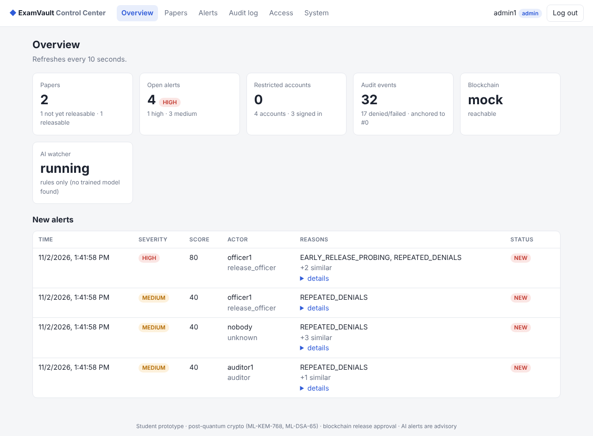

# controlcenter: access control, alert review and dashboard (Nayan's module)

> Originally Nayan's role ("Alerting, Access Control & Administrator Dashboard"). Built by Aditya
> with AI assistance after the team changed. Student prototype.



## What it adds to the system

| Area | What it does |
|---|---|
| **Accounts** | 4 roles (`admin`, `auditor`, `exam_authority`, `release_officer`). Passwords are hashed with **scrypt** and must pass a password policy. Accounts are stored in `keys/users.json` (git-ignored). |
| **Login** | Same error and timing for a wrong password and an unknown user. **5 failures → 15-minute lock.** Optional **TOTP two-factor** codes (RFC 6238, works with Google/Microsoft Authenticator), and a code cannot be reused. |
| **Sessions** | Random bearer tokens, stored on the server **only as SHA-256 hashes**. Expire after 30 min idle or 8 h total. Revoked on logout and on restriction. |
| **Restrictions** | An admin restricts an account, for a set time or until lifted, with a reason. **Enforced on every request.** The account's open sessions end immediately. Admins can't restrict themselves or the last admin. Full history is kept. |
| **AI alert review** | Lists Ansh's alerts. Admins can acknowledge them, mark them reviewing, or close them (closing requires a note), and can **restrict the account behind an alert**. The AI only *recommends*; a human decides. |
| **Audit** | Every login, logout, refusal and admin action is an event in examcrypto's **ML-DSA-signed, hash-chained** log. That log is anchored on Harsh's blockchain and scored by Ansh's AI. |
| **Dashboard** | Overview, Papers (authorities seal, officers release), Alerts, Audit log (verify + anchor), Access, System health. Plain JavaScript, no build step. Strict CSP and no inline scripts; all data is inserted as text. |
| **One server** | `python -m controlcenter serve` runs examcrypto's API, login, the admin API, the dashboard **and Ansh's AI watcher** in one process. On first start it trains the AI model automatically. |

## Run it (Windows PowerShell, venv active)

```powershell
cd aditya;  python -m examcrypto init-keys;  cd ..      # once (keys live in aditya\keys)
cd nayan
python -m controlcenter demo-users                      # once: 4 demo accounts, passwords printed ONCE
$env:EXAM_DEMO_MODE = "1"                               # mock chain + demo custodian button
python -m controlcenter serve                           # http://127.0.0.1:8000
```

Optional: `python -m controlcenter enable-mfa --username admin1` prints a setup key for an
authenticator app. After that, admin1 needs the 6-digit code to log in.

With the real blockchain, set `$env:EXAM_CHAIN = "gateway"` and add `--flag-on-chain` (see the
root `HOW_TO_RUN_EVERYTHING.md`).

## API

All routes need `Authorization: Bearer <token>` from `/auth/login`, except login itself.

| Method | Path | Roles |
|---|---|---|
| POST | `/api/v1/auth/login` `{username, password, totp?}` | anyone |
| POST | `/api/v1/auth/logout`, GET `/api/v1/auth/me` | signed in |
| GET | `/api/v1/dashboard/overview` | admin, auditor |
| GET | `/api/v1/dashboard/papers` | all four roles |
| GET | `/api/v1/alerts?severity=&status=` | admin, auditor |
| POST | `/api/v1/alerts/{id}/review` `{status, note}` | admin |
| POST | `/api/v1/alerts/{id}/restrict` `{hours?, reason?}` | admin |
| GET/POST | `/api/v1/access/users` | GET: admin, auditor · POST: admin |
| POST | `/api/v1/access/users/{u}/restrict` · `/unrestrict` `{reason, hours?}` | admin |
| GET | `/api/v1/access/restrictions`, `/api/v1/system/health` | admin, auditor |

Plus every examcrypto route (`/api/v1/papers…`, `/api/v1/events…`), now behind real logins.

**New status codes:**
- 401 `LOGIN_FAILED` / `MFA_REQUIRED` / `AUTH_REQUIRED`
- 403 `ACCOUNT_RESTRICTED` / `ROLE_NOT_ALLOWED`
- 429 `ACCOUNT_LOCKED`
- 409 `CONFLICT`

## Tests

**32 unit and API tests.** Run them with `python -m unittest discover -s tests`. They cover:
- the password hash and policy
- TOTP against the **RFC 6238 / RFC 4226 test vectors**, including replay protection
- lockout and lock expiry
- idle and absolute session expiry
- that only token hashes are stored
- restrictions: expiry, guards, and blocking an already-open session
- that the old dev tokens are refused
- the auditor being read-only
- the full AI-alert flow: watcher → review → restrict → locked out
- that a burst of failed logins becomes an alert
- that every action lands in the signed audit chain
- CSP and security headers

**Mutation-checked:** 14 deliberate security bugs, each caught by at least one test. Examples: a
restricted user keeps working, MFA can be skipped, TOTP replay is allowed, sessions never expire,
any password is accepted, there is no CSP, an auditor can act.

**Browser check** (`scripts/browser_check.py`, headless Chromium): 16/16 passed in the Linux test sandbox,
covering all four roles plus phone width. It found and fixed a real bug: the Exam-ID field's
pattern was invalid in modern browsers. Screenshots are in `docs/screenshots/`.

## Known limits (say these in the viva)

- **Sessions live in memory**, so restarting the server logs everyone out.
- The users file holds the **TOTP secrets**, so the `keys` folder must stay private.
- It runs on **Flask's development server, on localhost only.** A real deployment needs HTTPS
  and a production WSGI server.
- **No IP-based blocking.** Anonymous attackers (failed logins for non-existent users) are
  alerted on but can't be "restricted".
